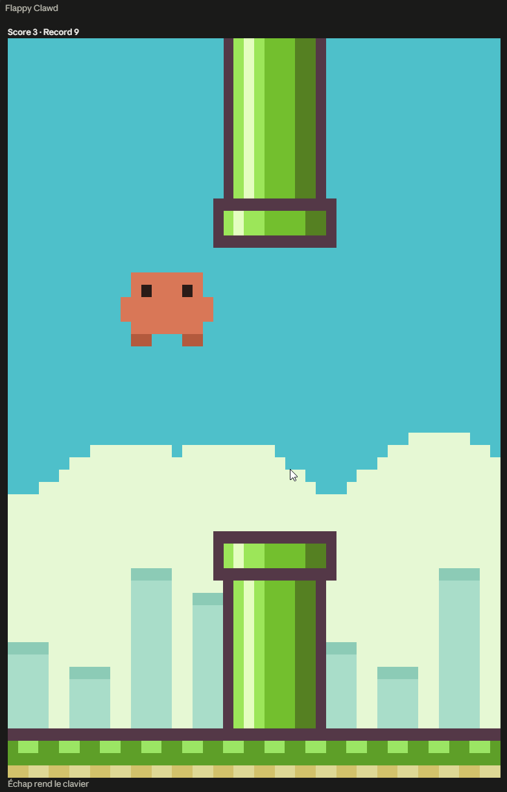

# Flappy Clawd

A tiny Flappy Bird clone for [Claude Code](https://claude.com/claude-code), starring Clawd, the Claude Code mascot. It lives in a side pane, so you have something to do while Claude is thinking.



## Features

- Pixel-art graphics: pipes with caps and shading, a scrolling skyline and ground, and an animated Clawd.
- Pipes come in pairs, with a gap to fly through, like the original.
- The game fills the whole pane and adapts to its size.
- Your best score is saved across sessions.
- The pane opens once per session when Claude starts working, and is never closed for you. Close it yourself whenever you like.

## Install

Flappy Clawd is a Claude Code plugin (a "mod") made of function hooks, written in TypeScript/JSX. It needs a Claude Code build with mod support, in the terminal or in the Code tab of the desktop app. There is nothing to build or install with a package manager: you point Claude Code at the folder.

First, clone the repository:

```bash
git clone https://github.com/gaelbenoit/flappy-clawd.git
```

### Terminal

Start Claude Code with the folder as a plugin directory. This loads the mod for that session only:

```bash
claude --plugin-dir /path/to/flappy-clawd
```

### Desktop app

The desktop app has no command-line flag, so use the `CLAUDE_CODE_PLUGIN_DIRS` environment variable instead. Add it to the `env` block of your user settings file, `~/.claude/settings.json` (on Windows, `C:\Users\<you>\.claude\settings.json`), with the absolute path of the cloned folder:

```json
{
  "env": {
    "CLAUDE_CODE_PLUGIN_DIRS": "C:\\Users\\<you>\\source\\repos\\flappy-clawd"
  }
}
```

Several folders can be listed, separated by your platform's path separator (`;` on Windows, `:` on macOS and Linux). Start a new session and the mod is loaded. In an interactive session, Claude Code watches that folder, so edits to the game reload on their own.

If the mod does not appear, look for a dim line in the transcript naming `flappy-clawd`: it says why a hook or the module failed to load. Running `claude --debug` gives more detail.

## How to play

Open the pane with `/flappy-clawd` (it also opens by itself the first time Claude starts a turn), then click the game once to give it the keyboard.

| Input | Action |
| --- | --- |
| Space, Enter, Up arrow or left click | Flap |
| R | Restart |
| Esc | Give the keyboard back to the prompt |

Fly through the gaps between the pipes. Touching a pipe or the ground ends the run. Press space (or click) to try again.

## How it works

- `hooks/register.tsx` registers the `/flappy-clawd` command, opens the pane, and stores the best score with `$.store`.
- `hooks/game.tsx` is a `Client` surface module: the game loop, physics and rendering all run locally at about 20 ticks per second, so playing never waits on the main session.
- Each game pixel is a solid block 2 columns wide and 1 row tall. Half-block glyphs were tried first but left visible lines between rows on the desktop.
- The render tree may not exceed 100,000 characters, so the game counts its colour runs each frame and lowers the horizontal resolution when it gets close to the limit.

## Project layout

```
.claude-plugin/plugin.json   plugin manifest
hooks/hooks.json             points at the hooks module
hooks/register.tsx           command, pane, high score
hooks/game.tsx               the game itself
docs/screenshot.png          screenshot used in this README
```

## License

[MIT](LICENSE)

## Disclaimer

An unofficial fan project. Not affiliated with or endorsed by Anthropic. Flappy Bird is a trademark of its respective owner; this project shares only the general game idea.
